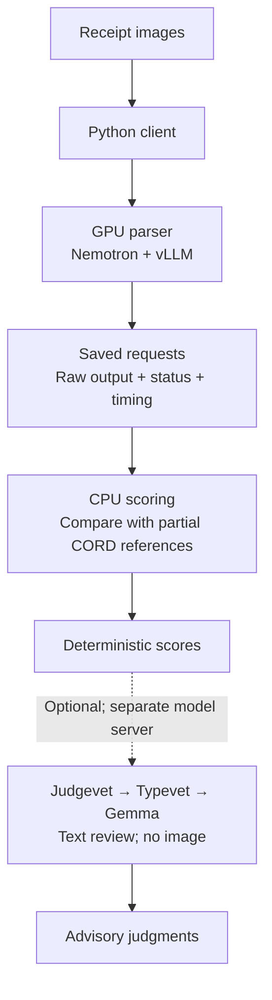

# How the experiment works

Kind: explanation.

The client and parser have separate environments.
A small Python client prepares images and sends HTTP requests.
A Podman container serves Nemotron-3.5-Parse through vLLM.
The model and serving dependencies are pinned in the container recipe.

## From images to reusable evidence

The saved requests are the boundary between inference and offline scoring.
You can recalculate scores without starting Nemotron again.
Optional review uses the text and partial references in the score file.
Its judgments do not feed back into the deterministic scores.

## Timing and safeguards

Preparation finishes before timed requests begin.
The client warms every receipt image before the measured sweeps.
Each sweep uses the same fixed corpus with a different concurrency limit.
There are no retries. Each request produces a terminal record.

Raw output and completion status are separate from text-quality scores.
A completed request can contain incorrect numbers or unrelated text.
The scorer reads saved requests, so changes to scoring do not require another GPU run.
It preserves original outputs and writes corrected calculations to a new file.

Container labels identify the checkout that owns a parser instance.
The lifecycle commands refuse to manage another checkout's container.
A free-memory check prevents startup when the configured reservation is unavailable.
The standard run does not manage other GPU services.

The optional judge is a separate text-review step through Judgevet and Typevet.
It consumes saved text and reference annotations after parser inference ends.
Its rubric probabilities supplement inspection; they do not become reference labels.
