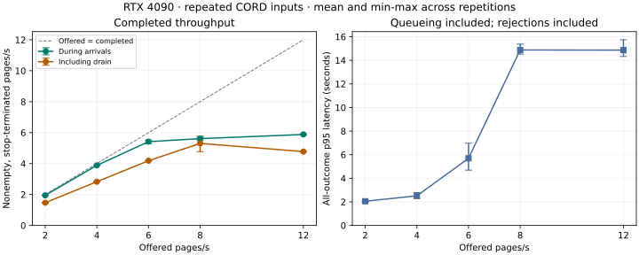

# RTX 4090 receipt scaling results

Kind: reference.

Observation date: 2026-10-27.

Five offered pages/s sustained low client queueing for five minutes.
Six offered pages/s grew a queue and eventually rejected work.
This brackets the observed queue-stable offered load between those tested points for this workload.
The short repeated-input curve approaches about 5.5–5.9 nonempty, stop-terminated pages/s during arrivals.
At 8 and 12 offered pages/s, the bounded client queue rejects requests in every repetition.
At 4 offered pages/s, queueing stays low, but pathological generation still causes timeouts and truncations.
No tested load establishes zero-failure service or correct receipt extraction.

## Scope and protocol

One RTX 4090 runs the unchanged pinned FA2/BF16/eager profile in `serving/config.json`.
The model and plugin revision remains `62cb1e4ba153d113ff64aaf2be6e068c377cf53c`.
CORD coverage uses 56 new documents, test rows 24–79.
Rows 80–99 remain reserved and uninspected.
The source revision is `7f0115a4b758a71d6473b8d085751692da2fef98`.
Images retain original embedded source bytes and source blurring.
The published 24-receipt pilot, its metric implementation and its tag remain unchanged.

The matrix contains three fresh-input trials and fifteen repeated-input trials.
Each repeated trial has 60 seconds of constant-rate arrivals, followed by drain.
Each fresh trial submits 56 unique inputs at 4 pages/s after a parser cache reset.
The fresh warmup uses a disjoint synthetic image.
Repeated trials warm all 56 receipts outside measurement.
The client uses 16 workers, 64 waiting slots, a 30-second arrival-based deadline and no retries.
The rate order rotates between repetitions.
All 5,928 planned measured requests have terminal outcomes.
The matrix also retains 843 warmup records.

## Saturation curve



Each interval below spans the three repetitions. These are ranges, not confidence intervals.
Success means nonempty output with stop termination. It does not mean correct text.

| Offered pages/s | Completed/s during arrivals | Completed/s with drain | All-outcome p95 seconds | Success / planned | Queue rejects | Timeouts | Truncations |
|---|---|---|---|---|---|---|---|
| 2 | 1.95–1.95 | 1.47–1.47 | 1.98–2.13 | 354 / 360 | 0 | 3 | 3 |
| 4 | 3.88–3.88 | 2.82–2.83 | 2.29–2.78 | 708 / 720 | 0 | 9 | 3 |
| 6 | 5.28–5.52 | 4.18–4.19 | 4.69–6.97 | 1061 / 1080 | 0 | 19 | 0 |
| 8 | 5.48–5.70 | 4.77–5.77 | 14.53–15.38 | 1240 / 1440 | 179 | 21 | 0 |
| 12 | 5.85–5.93 | 4.76–4.79 | 14.33–15.74 | 1288 / 2160 | 850 | 22 | 0 |

There were no recorded HTTP errors, malformed responses or empty-output failures in the matrix.
The rejected requests remain in the offered-work and quality denominators.
At overload, fast rejections can reduce a latency percentile even while service gets worse.
The machine-readable report also retains successful-response p95 latency.
Drain-inclusive throughput is lower when a late pathological generation runs to its deadline.
Accepted document mix can change when the queue rejects arrivals.

## Five-minute stability checks

Each longer condition ran once with the same 16 workers, 64 waiting slots and 30-second deadline.
These trials refine the short curve; they do not provide repeated long-run uncertainty estimates.

| Offered pages/s | Planned | Normal completions | Queue rejects | Timeouts | Completed/s during arrivals | Completed/s with drain | All-outcome p95 s | Client queue p95 s |
|---|---|---|---|---|---|---|---|---|
| 5 | 1,500 | 1,474 | 0 | 26 | 4.897 | 4.614 | 3.195 | 0.036 |
| 6 | 1,800 | 1,751 | 15 | 34 | 5.593 | 5.352 | 14.202 | 10.965 |

At 6 pages/s, mean queue time grew from 1.56 seconds in minute one to 10.39 seconds in minute five.
The full queue rejected requests in minutes four and five.
A one-minute run therefore understated the overload risk at this rate.
At 5 pages/s, all 26 timeouts were receipt 71.
That run avoided queue rejection but still had a 1.73% generation-timeout rate.
It does not establish reliable or correct service at 5 pages/s.
The exact knee inside the tested 5-to-6 interval remains unresolved.

The maximum recorded arrival lag was 0.99 seconds in the 5 pages/s trial.
Arrival times are target times; actual submission has observable jitter.
End-to-end latency includes that lag.
The record retains each scheduled time and outcome.
All 9,228 measured requests across the matrix and longer trials have terminal records.
The three final suites also retain 955 separate warmup outcomes.
All three final suites verified restoration of `gemma-4-31b-kv9-text` on llama.cpp.

## Resource evidence

These ranges describe the per-trial means during arrival windows.
Container CPU cores come from CPU-time counter differences, not the lifetime average percentage.
Telemetry collection reported no errors in the matrix.

| Offered pages/s | GPU utilization % | Container CPU cores | Server running requests | Server waiting requests |
|---|---|---|---|---|
| 2 | 33.19–50.34 | 1.00–1.01 | 1.79–1.95 | 0.00–0.00 |
| 4 | 49.19–66.00 | 1.05–1.06 | 4.34–4.68 | 0.00–0.00 |
| 6 | 62.38–68.30 | 1.07–1.09 | 7.32–7.38 | 3.70–4.57 |
| 8 | 66.09–69.79 | 1.07–1.08 | 7.82–7.84 | 6.52–6.88 |
| 12 | 68.14–73.02 | 1.08–1.09 | 7.84–7.86 | 7.07–7.14 |

The serving profile permits eight concurrent sequences.
At overload, samples show almost all eight running and additional requests waiting at the server.
Client arrival scheduling continues independently of those completions.
Prepared images are already encoded before measurement.
The evidence locates pressure in serving and generation, rather than in this client's image preparation.
It does not isolate CPU orchestration, GPU decode kernels or the sequence limit as the sole cause.
GPU utilization below 100% is not proof of spare end-to-end capacity.
A controlled serving-profile or profiler experiment is still needed to separate those causes.

## Fresh-input quality coverage

| Trial | Normal completions | Truncations | Exact numeric matches | Numeric recall | ROUGE-L F1 |
|---|---|---|---|---|---|
| fresh-0 | 55 / 56 | 1 | 511 / 635 | 80.47% | 0.774 |
| fresh-1 | 55 / 56 | 1 | 514 / 635 | 80.94% | 0.774 |
| fresh-2 | 55 / 56 | 1 | 516 / 635 | 81.26% | 0.777 |

Fresh trials recorded no observed multimodal-cache hits.
Repeated trials recorded cache hits for all queries in the sampled counter intervals.
The 14-second fresh arrival windows are too short to establish sustained fresh-input capacity.
These are partial-reference diagnostic metrics, not official CORD scores or page accuracy.
They do not establish layout correctness or amount-to-field association.
Lower recall under overload includes requests rejected before inference; it does not prove degraded model recognition.
The new samples and original-byte encoding prevent a controlled comparison with the pilot's JPEG-encoded inputs.

## Failure evidence and next experiment

Receipts 49 and 66 repeat verified digit changes in all three fresh trials.
Receipt 32 repeats separator changes.
Receipt 71 emits unrelated repeated characters and reaches the 8,744-token limit in every fresh trial.
It accounts for about 49% of returned output tokens in the first two fresh trials.
Output-token share is not GPU-time share.

An escaped-percent diagnostic changes the first fresh trial from 511 to 524 numeric matches of 635.
That gain comes from formatting interpretation; raw predictions and baseline scores remain unchanged.
Receipt 53 also exposes a source-annotation discrepancy: `57` instead of visible `5%`.
See the [failure review](scaling-failures.md) for source checks, hashes, suspected categories and annotation gaps.

The next correction experiment should compare the fixed full-page prompt with human-verified text-region crops.
Test whether region extraction reduces unrelated generation, missed fields and changed digits.
Keep the pinned model and source images fixed.
Count added inference cost and any lost context.
Freeze the method before opening reserved rows 80–99.
No automatic correction, model-judge ground truth or GEPA optimization was added.

## Reproduction and retained evidence

Exact matrix command:

```sh
uv run python scripts/scaling_suite.py \
  --input corpus/cord-scaling-56 --output runs/scaling-4090-matrix-v2 \
  --warmup-image corpus/page-01.png --release-llama
```

Exact longer-trial commands (each runs only its stability condition):

```sh
uv run python scripts/scaling_suite.py \
  --input corpus/cord-scaling-56 --output runs/scaling-4090-stability-5 \
  --warmup-image corpus/page-01.png --release-llama \
  --stability-rate 5 --stability-seconds 300
uv run python scripts/scaling_suite.py \
  --input corpus/cord-scaling-56 --output runs/scaling-4090-stability-6 \
  --warmup-image corpus/page-01.png --release-llama \
  --stability-rate 6 --stability-seconds 300
```

Use the [scaling procedure](../how-to/run-scaling.md) to prepare the corpus, authorize handover, resume or rescore.
`evidence/scaling-4090/matrix.json` contains all per-trial summaries and resource ranges.
`evidence/scaling-4090/matrix-audit.json` records checks of all planned identities and evidence hashes.
`evidence/scaling-4090/stability-5.json` and `stability-6.json` contain the longer-trial reports.
`stability-audit.json` records identity checks and per-minute queue observations.
The runtime snapshot records the container, image, packages, GPU, driver and executable source.
Raw HTTP bodies, terminal outcomes, warmups, plans, telemetry and logs are in
`evidence/scaling-4090/raw-evidence.tar.gz`.
`archive-index.json` records its SHA-256 and verified file count.
The archive includes the excluded exploratory run and exact source/lockfile snapshots.
Images and weights are excluded; original images can be regenerated from the pinned dataset.
The procedure includes extraction and offline-rescore commands.

## Limits and excluded exploration

The initial run in `runs/scaling-4090-20261027` stopped after a truncated warmup.
Its first fresh trial and all warmup records remain preserved as exploratory evidence.
The corrected matrix accepts truncated or empty warmup output as a quality observation.
It still stops on a warmup transport or protocol failure.
The exploratory run, matrix and both longer runs verified llama.cpp restoration.
The final runner also records intent before warmup, so interruption cannot silently lose that attempt.
That durability enhancement was added after the matrix; source snapshots distinguish the measured versions.

Three short repetitions and one longer trial per extra rate give limited uncertainty evidence.
Persistence and telemetry overhead were not subtracted from the measurements.
The fixed-duration counts slightly overweight early documents when the count is not divisible by 56.
The workstation and desktop graphics remain active.
Timeouts censor server completion and may omit a response body the client never received.
No zero-failure rate, production latency guarantee or general-document capacity is established.
PSAI screenshot OCR remains a separate candidate study; its task labels are not text transcriptions.
