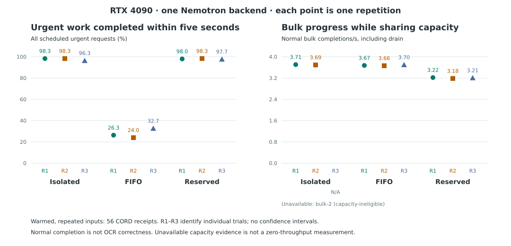

# Shared-capacity results

Kind: reference.

## Outcome

The 2026-10-28 experiment measured urgent protection at a cost to bulk progress.
Urgent on-time normal completion rose from 24.0–32.7% with FIFO to 97.7–98.3%
with urgent priority and two reserved dispatch slots.
Bulk throughput including drain fell 12.4–13.3% in the paired trials.
The reserved policy produced 40–49 fewer normal bulk completions per 1,200 scheduled requests.
These ranges describe three repetitions. They are not confidence intervals.

All 13,500 scheduled requests have terminal outcomes and policy evidence.
All three mixed pairs are eligible for comparison.
One isolated bulk trial lost transport certainty and is ineligible for capacity comparison.
Its outcomes remain in the evidence.
The real GPU test passed. The original Gemma service and loaded model were restored.

## Frozen controls

The [method](../explanation/shared-capacity-method.md) defines the hypotheses and controls.
Each condition uses a 300-second arrival window on one RTX 4090.
Urgent requests arrive once per second. Bulk bursts contain 120 requests every 30 seconds.
The urgent deadline is five seconds from scheduled arrival.
The bulk dispatch wait limit is 60 seconds. The drain allowance is 180 seconds.
Both mixed policies limit upstream concurrency to eight.
The reserved policy limits bulk concurrency to six and selects urgent work first.
Urgent work can use other free slots. Bulk work cannot borrow reserved slots.

All conditions repeat CORD rows 24–79 after a separate full-corpus warmup.
Receipt 71 remains included. Rows 80–99 remain reserved and unused.
The model and plugin share revision `62cb1e4ba153d113ff64aaf2be6e068c377cf53c`.
The image contains vLLM 0.26.0 and nemotron-parse 3.5.0.post7.
The suite restarts its owned parser before each condition.
The frozen order rotates isolated workloads and then mixed policies.
No deadline, output limit or traffic setting changed after measurement began.

## Urgent outcomes

Attainment divides on-time normal completions by all 300 scheduled urgent requests.
Deadline misses include rejected, truncated and late normal responses.
Latency begins at scheduled arrival. The p95 column includes normal completions only.
Normal termination does not establish OCR correctness.

| Condition | On time / 300 | Attainment | Deadline misses | Normal p95 s | Queue expired | Truncated |
|---|---:|---:|---:|---:|---:|---:|
| Isolated 0 | 295 | 98.3% | 5 | 1.837 | 0 | 5 |
| Isolated 1 | 295 | 98.3% | 5 | 1.894 | 0 | 5 |
| Isolated 2 | 289 | 96.3% | 11 | 2.202 | 3 | 5 |
| FIFO 0 | 79 | 26.3% | 221 | 5.809 | 210 | 0 |
| FIFO 1 | 72 | 24.0% | 228 | 5.661 | 217 | 0 |
| FIFO 2 | 98 | 32.7% | 202 | 5.079 | 196 | 0 |
| Reserved 0 | 294 | 98.0% | 6 | 2.413 | 0 | 6 |
| Reserved 1 | 295 | 98.3% | 5 | 2.327 | 0 | 5 |
| Reserved 2 | 293 | 97.7% | 7 | 2.261 | 0 | 6 |

FIFO had 11, 11 and six late normal urgent responses.
Reserved repetition 2 had one. Isolated repetition 2 had three.
FIFO interference is established for this offered trace and deadline.
This result does not establish indefinite starvation.

## Bulk progress and unfinished work

Each bulk-containing condition schedules 1,200 requests.
Arrival throughput counts normal completions inside the arrival window.
Drain throughput divides all normal completions by elapsed time through the final outcome.
The failed isolated trial has no eligible capacity rate.

| Condition | Normal / 1,200 | Arrival normal/s | Drain normal/s | Maximum wait s | Elapsed through drain s |
|---|---:|---:|---:|---:|---:|
| Isolated 0 | 1,178 | 3.927 | 3.705 | 27.192 | 317.919 |
| Isolated 1 | 1,176 | 3.920 | 3.692 | 26.880 | 318.539 |
| Isolated 2 | 406 | Ineligible | Ineligible | 45.636 | 285.835 |
| FIFO 0 | 1,175 | 3.917 | 3.673 | 27.995 | 319.890 |
| FIFO 1 | 1,176 | 3.920 | 3.664 | 30.438 | 320.959 |
| FIFO 2 | 1,179 | 3.930 | 3.698 | 24.728 | 318.853 |
| Reserved 0 | 1,135 | 3.380 | 3.219 | 60.048 | 352.601 |
| Reserved 1 | 1,127 | 3.367 | 3.184 | 60.287 | 353.965 |
| Reserved 2 | 1,132 | 3.397 | 3.206 | 60.062 | 353.139 |

| Condition | Deferred | Queue expired | Truncated | Other failures | Unfinished normal work |
|---|---:|---:|---:|---:|---:|
| Isolated 0 | 1,142 | 0 | 22 | 0 | 22 |
| Isolated 1 | 1,144 | 0 | 24 | 0 | 24 |
| Isolated 2 | 472 | 0 | 9 | 1 error; 784 backend uncertain | 794 |
| FIFO 0 | 1,154 | 0 | 25 | 0 | 25 |
| FIFO 1 | 1,155 | 0 | 24 | 0 | 24 |
| FIFO 2 | 1,145 | 0 | 21 | 0 | 21 |
| Reserved 0 | 1,190 | 45 | 20 | 0 | 65 |
| Reserved 1 | 1,190 | 52 | 21 | 0 | 73 |
| Reserved 2 | 1,190 | 47 | 21 | 0 | 68 |

Deferred counts overlap terminal outcomes. They are not additional failures.
Every bulk job has unfinished normal work, so whole-job completion time is unknown.
Elapsed time through drain is not whole-job completion time.
No trial recorded a client timeout or an HTTP-status failure.
The connection error below has no HTTP status.
Expiry recording can lag the 60-second eligibility limit.
The audit found no dispatch after that limit; the largest recorded wait was 60.287 seconds.

## Paired policy costs

Each row subtracts FIFO from reserved capacity for the identical mixed trace.

| Repetition | Urgent attainment gain, percentage points | Bulk normal change | Bulk drain throughput change | Unused reserved slot-seconds while bulk waits |
|---|---:|---:|---:|---:|
| 0 | +71.7 | −40 | −12.4% | 171.168 |
| 1 | +74.3 | −49 | −13.1% | 184.898 |
| 2 | +65.0 | −47 | −13.3% | 173.394 |

Unused dispatch slots do not mean the GPU was idle for that duration.
The policy combines urgent priority with static reservation.
There is no priority-only ablation, so the experiment cannot separate their effects.
The policy retains its bulk cap during drain after urgent arrivals stop.
Its costs depend on this conservative rule and the fixed bulk wait limit.
The experiment does not show that these costs are necessary or optimal.
The machine report includes mixed-minus-isolated comparisons for both classes.
Ten of twelve baseline comparisons are eligible; those against bulk repetition 2 are excluded.

## Preserved exceptions

Isolated urgent repetition 2 had scheduler delay near arrivals 249–251 seconds.
Three requests expired with waits of 5.140–6.403 seconds.
A nearby telemetry gap reached 7.933 seconds.
The cause is unproven. These observations do not establish a CPU bottleneck.
All three expiries and three late normal responses remain in the result.

Isolated bulk repetition 2 had a connection error on bulk sequence 413, CORD row 45.
It was scheduled at 90 seconds and dispatched at 116.237 seconds.
The client observed failure at 135.636 seconds with no HTTP status.
The runner stopped new dispatch because backend execution was uncertain.
It recorded 784 remaining requests as backend uncertain.
The server container remained running, but its logs did not identify the cause.
The client retained only a generic connection diagnostic.
One metrics collection error also occurred in this arm.
The next arm used a fresh owned parser. The failed arm was not replaced.

## OCR diagnostics

The report retains numeric recall, ROUGE and counts of quality suspects.
All-scheduled quality scores include empty text for rejected work.
They therefore reflect both admission outcomes and output text.
Urgent numeric recall was 0.2217–0.2764 for FIFO and 0.8104–0.8151 for reservation.
Bulk numeric recall was 0.8083–0.8100 for FIFO and 0.7722–0.7784 for reservation.
These differences do not prove that the policy changed OCR ability.

Missing-reference-number suspects also occur among normal responses:

| Condition | Urgent suspects / normal responses | Bulk suspects / normal responses |
|---|---|---|
| Isolated 0 | 208 / 295 | 841 / 1,178 |
| Isolated 1 | 208 / 295 | 835 / 1,176 |
| Isolated 2 | 205 / 292 | 287 / 406 |
| FIFO 0 | 63 / 90 | 835 / 1,175 |
| FIFO 1 | 58 / 83 | 834 / 1,176 |
| FIFO 2 | 73 / 104 | 837 / 1,179 |
| Reserved 0 | 207 / 294 | 809 / 1,135 |
| Reserved 1 | 208 / 295 | 799 / 1,127 |
| Reserved 2 | 207 / 294 | 805 / 1,132 |

CORD references cover selected fields and contain known annotation limitations.
Exact numeric matching does not validate field association or full-page accuracy.
Verified correct output counts remain unknown.
Receipt 71 caused the five truncations in each isolated urgent repetition.
Other receipts also truncated in bulk work. No failed input was removed.

## Runtime and evidence

The independent audit checked all outcomes, canonical traces, source hashes,
runtime identity, actual dispatch occupancy and failure handling.
Mixed concurrency peaked at eight; reserved bulk concurrency peaked at six.
Sampled server waiting counts were zero. Sampling cannot rule out transient queues.
Mean sampled GPU utilization was 59.1–62.9% across the mixed trials.
This does not identify a CPU bottleneck.
Sampled multimodal cache query and hit deltas matched in every arm.
The workload is warmed receipt repetition, not fresh enterprise ingress.

The evidence bundle is in `evidence/shared-capacity-4090/`.
It includes the machine report, independent audit, frozen protocol and raw archive.
The [procedure](../how-to/run-shared-capacity.md) explains offline reproduction.
The measured source commit is `0861a9bb78b17e7c364390c6774ac7f9e5a3acee`.
The mixed trace SHA-256 is `7e758eaa950c5f094c03cf79841111f0294d1ea334da780fff7451c0e6878ea5`.
The final report SHA-256 is `925dedbb8f3b2eea6312bf970892f07b380184b3ed71d790273583f307c51d98`.

The required offline checks passed, including 125 tests and the strict documentation build.
The separate real GPU check passed against the demo server.
Lifecycle and live checks confirm restoration of `gemma-4-31b-kv9-text`
and removal of the owned parser.
The [independent review](shared-capacity-review.md) records acceptance and judgment agreement.

This experiment establishes a local shared-capacity tradeoff under the frozen workload.
It does not establish enterprise scale, fresh-input capacity, availability, security,
tenant isolation, multi-model operation or production deadline guarantees.
[Release v0.3.0](../releases/v0.3.0.md) and the companion article
[I gave urgent receipts priority. The bulk import paid for it.](https://alberto.codes/blog/2026-10-28-urgent-receipts-bulk-import)
form one coordinated publication pair.
